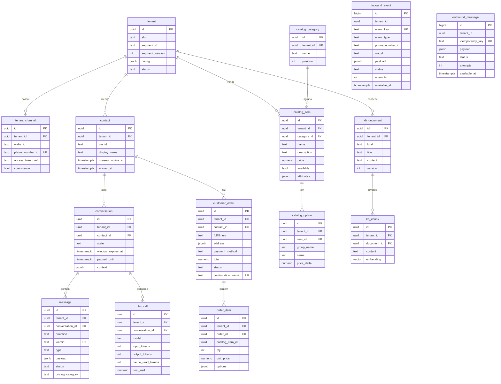

# Arquitetura — Conversa

> Nome provisório do projeto: **auto-msg** (codinome no código: Conversa, pacote `br.com.conversa`).
> Documento vivo: decisões com trade-offs ficam em [`docs/adr/`](adr/); este arquivo descreve o *como*.

## 1. Visão geral

Plataforma multi-tenant de atendimento automatizado no WhatsApp (Cloud API oficial da Meta),
com motor de conversa híbrido (fluxos determinísticos + LLM com tool calling), transbordo
para humano e base de conhecimento por empresa.

Princípios:

1. **Núcleo genérico, segmento como pacote.** Nada de `if (restaurante)` no núcleo. Tudo que é
   específico de segmento vive em um *Segment Pack* (ferramentas, fluxos, prompts, schema de
   configuração). Cada empresa (tenant) escolhe um pack e o customiza por configuração.
2. **O LLM conversa; o código decide.** O LLM entende linguagem livre e escolhe ferramentas.
   Dados de negócio (preço, horário, taxa) só vêm de ferramentas. Ações irreversíveis
   (confirmar pedido) só acontecem por um passo determinístico com botão de confirmação.
3. **Webhook rápido, processamento assíncrono, idempotente.** O webhook só valida, grava e
   responde 200. Todo o resto roda em workers a partir de filas no PostgreSQL.
4. **Isolamento de dados por tenant desde o dia 1** (`tenant_id` + Row-Level Security).
5. **Monólito modular.** Um deployable, módulos Maven com fronteiras verificadas por ArchUnit.
   Extrair serviços só quando houver motivo medido.

## 2. Contexto e restrições que moldam o design

Verificado na documentação da Meta em 28/10/2026 (ver [ADR-001](adr/ADR-001-integracao-whatsapp.md)):

| Fato | Impacto no design |
|---|---|
| Desde 15/01/2026 os termos proíbem **assistentes de IA de propósito geral** na plataforma; IA para atendimento do próprio negócio é permitida. | O bot é restrito ao escopo da empresa: prompt com *scope guard*, recusa educada de assuntos fora do negócio, nada de "pergunte qualquer coisa". |
| Cobrança **por mensagem entregue** (desde 07/2025). Em **01/10/2026** mensagens de serviço (texto livre na janela de 24h) passaram a ser cobradas acima de **1.000/mês por número**, e templates *utility* dentro da janela deixaram de ser grátis. | Cada resposta do bot custa. Consolidar respostas em uma mensagem, evitar "bolhas" múltiplas, registrar o `pricing` dos webhooks de status por tenant. Estimativa a 50 pedidos/dia: ~10–15 mil mensagens/mês → acima da franquia. Conferir tarifa BRL no rate card antes de precificar o produto. |
| **Coexistência** (mesmo número no app WhatsApp Business + Cloud API): eco das mensagens enviadas pelo app via webhook `smb_message_echoes`; vazão fixa de 20 msg/s; exige Embedded Signup e que sejamos **Tech Provider/Solution Partner** (ou usar um BSP que suporte). | Transbordo usa o app do restaurante (decisão do cliente). Ecos pausam o bot. Onboarding da Meta é caminho crítico. |
| Na coexistência: **sem grupos**, sem listas de transmissão novas, sem catálogo/mensagens de ausência/respostas rápidas do app; **WhatsApp para Windows não é companion suportado** (mensagens enviadas por ele não geram eco). | Equipe não pode ser notificada em grupo → notificação por painel + mensagem individual a números da equipe (template utility, pago). Restaurante não pode atender pelo WhatsApp Windows (bot não veria o humano). |
| Mensagens enviadas pelo app **não abrem nem estendem** a janela de 24h da API. | A janela é calculada só a partir de mensagens do cliente. |
| Fora da janela de 24h só é possível enviar **templates aprovados**. | Notificações tardias (ex.: "pedido saiu") usam template utility se a janela fechou. |

## 3. Componentes


### Módulos Maven

| Módulo | Responsabilidade | Pode depender de |
|---|---|---|
| `platform-core` | Kernel do domínio: tipos de tenant/conversa, **SPIs** (`SegmentPack`, `Tool`, `LlmClient`, `ChannelGateway`). Sem Spring Web, sem JPA. | JDK |
| `channel-whatsapp` | Adaptador Cloud API: verificação de webhook, assinatura `X-Hub-Signature-256`, parsing de payload, envio (texto, interativo, template, mídia), status. | `platform-core` |
| `llm-anthropic` | Implementação de `LlmClient` com o SDK oficial `com.anthropic:anthropic-java`. | `platform-core` |
| `segment-restaurant` | Segment Pack de restaurante: ferramentas (cardápio, taxa de entrega, carrinho), fluxos (checkout), prompts, schema de configuração. | `platform-core` |
| `platform-app` | Spring Boot: composição, persistência (JPA + Flyway), filas, workers, API REST/SSE do painel, segurança, observabilidade. | todos |

Regra: **segmentos e adaptadores nunca dependem uns dos outros** — só do `platform-core`.
`ArchitectureTest` (ArchUnit) quebra o build se isso for violado.

## 4. Fluxo de uma mensagem (webhook → resposta)

```mermaid
sequenceDiagram
    autonumber
    participant C as Cliente (WhatsApp)
    participant M as Meta Cloud API
    participant W as WebhookController
    participant Q as inbound_event (PG)
    participant K as InboundWorker
    participant E as ConversationEngine
    participant L as LlmClient (Claude)
    participant T as Tools (Segment Pack)
    participant O as outbound_message (PG)
    participant S as SenderWorker

    C->>M: "tem pizza de calabresa? quanto custa?"
    M->>W: POST /webhooks/whatsapp (payload + X-Hub-Signature-256)
    W->>W: valida HMAC-SHA256 (app secret) sobre o corpo cru
    W->>Q: INSERT ... ON CONFLICT (event_key) DO NOTHING
    W-->>M: 200 OK (< 100 ms)
    K->>Q: SELECT ... FOR UPDATE SKIP LOCKED
    K->>K: resolve tenant por phone_number_id; lock por conversa (advisory lock)
    K->>E: InboundMessage normalizada (tenant, contato, conversa)
    E->>E: guards: LGPD/opt-out · consentimento · estado HUMAN? · horário
    alt fluxo determinístico aguardando (ex.: botão "Confirmar pedido")
        E->>E: FlowRuntime avança estado
    else linguagem livre
        E->>L: system (pack + tenant) + histórico + tools
        L-->>E: tool_use search_menu("calabresa")
        E->>T: search_menu (consulta catálogo do tenant)
        T-->>E: itens + preços
        E->>L: tool_result
        L-->>E: texto final
    end
    E->>O: INSERT resposta (idempotency key = inbound wamid + seq)
    E->>Q: marca evento como PROCESSED (mesma transação)
    S->>O: claim pendentes
    S->>S: janela 24h aberta? senão exige template
    S->>M: POST /{phone_number_id}/messages
    M-->>S: wamid
    M->>W: webhook status (sent/delivered/read + pricing)
    W->>Q: status → atualiza message + custo do tenant
```

Pontos importantes:

- **Webhook implementado (M1):** `GET|POST /webhooks/whatsapp`. Cada notificação é dividida
  em eventos atômicos com chave `msg:<wamid>`, `status:<wamid>:<status>`, `echo:<wamid>` ou
  `<field>:<sha256 do change>` (demais campos). Assinatura inválida → 401; payload assinado mas
  inválido → 400; caso contrário 200, inclusive para duplicatas. `tenant_id` fica nulo até a
  resolução por `phone_number_id` (M3).
- **Idempotência em 3 níveis:** `inbound_event.event_key` único (wamid da mensagem ou
  `wamid:status`), `outbound_message.idempotency_key` único, e efeitos de negócio (ex.: criar
  pedido) com chave natural (`order.confirmation_wamid`).
- **Ordenação:** mensagens da mesma conversa são processadas em série (advisory lock por
  `(tenant_id, wa_id)`); conversas diferentes em paralelo (virtual threads).
- **Debounce:** cliente que manda 3 mensagens seguidas ("oi" / "quero pizza" / "calabresa")
  — o worker aguarda ~2 s de silêncio e processa o lote junto, economizando chamadas ao LLM
  e mensagens pagas.
- **Falhas:** retry com backoff exponencial; após N tentativas o evento vai para `FAILED`
  (dead letter) e a conversa é marcada para humano.

## 5. Motor de conversa

Detalhes e trade-offs em [ADR-002](adr/ADR-002-motor-de-conversa.md). Pipeline por turno:

1. **Normalização** — texto, resposta de botão/lista (`interactive.button_reply.id`),
   localização, mídia, áudio (MVP: pede para escrever; transcrição na fase 2).
2. **Guards determinísticos** (sempre antes do LLM):
   comandos LGPD ("apagar meus dados"), opt-out, aviso de privacidade no 1º contato,
   conversa em `HUMAN` (só registra), fora do horário (resposta configurável).
3. **Flow runtime** — fluxos declarativos (YAML no pack, sobrescritos por tenant): máquinas de
   estado com *slots* (ex.: checkout: tipo de entrega → endereço → pagamento → troco →
   confirmação). Entrada estruturada (id de botão) avança o fluxo direto, sem LLM.
   Texto livre dentro de um fluxo vai ao LLM com uma ferramenta de *slot filling*.
4. **LLM turn** — prompt = pacote do segmento + configuração do tenant (tom, nome do
   atendente virtual, regras) + estado da conversa (carrinho). O LLM só pode afirmar fatos
   que vieram de ferramentas. Limite de iterações de ferramenta por turno.
5. **Renderização** — o código monta mensagens interativas (botões/listas) a partir dos
   resultados das ferramentas; o LLM escreve o texto.

Estados da conversa: `BOT` → `HUMAN` (pausado até `paused_until`) → `BOT`; `CLOSED` após
inatividade.

## 6. Transbordo para humano (coexistência)

Ver [ADR-008](adr/ADR-008-transbordo-humano.md).

- **Gatilhos:** cliente pede ("falar com atendente"), ferramenta `request_human` chamada pelo
  LLM, N falhas de entendimento seguidas, erro técnico, ou **eco de mensagem enviada pelo app**
  (`smb_message_echoes`) — o humano começou a responder, o bot sai da frente.
- **Pausa:** `paused_until = now + handoff.pause_minutes` (padrão 60), renovado a cada eco.
- **Retorno ao bot:** expiração da pausa ou botão "devolver ao bot" no painel.
- **Aviso à equipe:** card no painel + mensagem para os números da equipe configurados.

## 7. Modelo multi-tenant e segmentos

Ver [ADR-003](adr/ADR-003-multi-tenancy.md).

```text
Plataforma (defaults)
  └── Segment Pack "restaurant" v1   (tools, flows, prompts, config schema, defaults)
        └── Tenant "Restaurante X"   (overrides validados contra o schema do pack)
```

- **Segment Pack** = bean Spring que implementa `SegmentPack` (SPI em `platform-core`):
  `id`, `version`, `tools()`, recursos em `classpath:segments/<id>/` (`flows/*.yaml`,
  `prompts/*.md`, `config-schema.json`, `defaults.yaml`).
- **Tenant** escolhe `segment_id` + `segment_version` e guarda `config` (JSONB) validado pelo
  schema: tom de voz, nome do assistente, ferramentas habilitadas, regras (pedido mínimo,
  formas de pagamento, bairros e taxas), textos de fluxo, números da equipe, retenção.
- **Precedência:** plataforma < pack < tenant.
- **Dados genéricos no núcleo** (servem a vários segmentos): catálogo (itens, categorias,
  opções, preços, `attributes jsonb`), horários, endereço/área de atendimento, FAQ/políticas,
  contatos. **Dados específicos no pack:** pedido de delivery (restaurante), agendamento
  (clínica/salão, futuro), reserva (futuro).
- **Isolamento:** todas as tabelas de negócio têm `tenant_id` + **RLS** com
  `current_setting('app.tenant_id')`, definido por `SET LOCAL` no início de cada transação.
  A aplicação usa um role sem `BYPASSRLS`; migrações rodam com outro role.
  Tabelas de fila (`inbound_event`, `outbound_message`) carregam `tenant_id` mas não têm RLS,
  porque o claim é cross-tenant; o worker fixa o tenant antes de tocar dados de negócio.

## 8. Modelo de dados inicial



Também previstas: `business_hours`, `delivery_zone` (bairro → taxa), `staff_user`,
`audit_log`, `data_subject_request`. Horários e zonas podem começar dentro de `tenant.config`
e virar tabelas quando o painel passar a editá-los.

## 9. Fila e assincronismo

PostgreSQL como fila (`FOR UPDATE SKIP LOCKED`), sem broker no MVP — ver
[ADR-004](adr/ADR-004-fila-processamento-assincrono.md). Workers em virtual threads,
polling curto + `LISTEN/NOTIFY` para latência baixa. Interface `JobQueue` permite trocar por
RabbitMQ/SQS se o volume justificar.

## 10. LLM

`LlmClient` (porta neutra em `platform-core`) + adaptador Anthropic — ver
[ADR-005](adr/ADR-005-provedor-llm.md). Prompt caching com prefixo estável
(tools → system do pack → config do tenant) e estado volátil no fim. Custo por chamada gravado
em `llm_call` e agregado por tenant.

## 11. Base de conhecimento

Ver [ADR-006](adr/ADR-006-base-de-conhecimento.md). Para restaurante, **dados estruturados via
ferramentas** (cardápio, preços, taxas, horários) + **FAQ/políticas no prompt** (são pequenos e
ficam no cache). RAG com pgvector só quando o conhecimento textual de um tenant passar de
~20–30 mil tokens. A extensão `vector` já é criada na migração inicial.

## 12. Painel (MVP)

Decidido: **painel de pedidos** no MVP (lista em tempo real via SSE, alerta sonoro, mudança de
status que notifica o cliente) + **mensagem para a equipe no WhatsApp**. Atendimento humano é
feito **no app WhatsApp Business** (coexistência). Painel de conversas e editor de base de
conhecimento ficam para a fase 2; até lá, conteúdo é carregado por seed/importação de planilha.

Tecnologia: o painel é um **frontend separado, em repositório próprio** (`auto-msg-frontend`,
criado no M8; stack a definir, sugestão React + Vite + TypeScript). Este repositório
(`auto-msg-backend`) expõe para ele uma **API REST** (`/api/v1/...`) e um stream **SSE** de
eventos de pedido, autenticados com usuários da equipe do tenant (sessão via cookie HttpOnly
ou JWT, a decidir no M8). O contrato é publicado em OpenAPI. Ver
[ADR-009](adr/ADR-009-frontend-repositorio-separado.md).

## 13. LGPD

- **Papéis:** restaurante = controlador; plataforma = operadora (contrato/DPA). Anthropic e
  Meta como suboperadores — transferência internacional informada na política de privacidade.
- **Base legal:** execução de contrato/procedimentos preliminares (pedido) e legítimo
  interesse (dúvidas). **Consentimento explícito só para marketing** (fase 2).
- **Aviso no primeiro contato** com link para a política; registro em `contact.consent_notice_at`.
- **Minimização:** ao LLM vai só o necessário (primeiro nome, nunca o telefone completo).
- **Retenção configurável por tenant:** mensagens (padrão 180 dias) → apagadas; pedidos →
  mantidos para fins fiscais, com dados pessoais anonimizados após o prazo.
- **Direitos do titular:** comando "apagar meus dados" (e via painel) → `data_subject_request`
  → job de anonimização do contato, exclusão de mensagens, confirmação ao cliente.

## 14. Observabilidade

- Logs JSON estruturados (`logging.structured.format.console=ecs`) com MDC: `tenant_id`,
  `conversation_id`, `wamid`, `trace_id`.
- Micrometer + OpenTelemetry: um *trace* por mensagem recebida, com spans de LLM, ferramentas
  e envio.
- Métricas: latência do webhook, atraso da fila (idade do evento mais antigo), taxa de erro,
  tokens/custo de LLM por tenant, mensagens WhatsApp por categoria de cobrança por tenant,
  taxa de transbordo.
- Actuator: `/actuator/health` (liveness/readiness), `/actuator/prometheus`.

## 15. Deploy

VPS única com Docker Compose (app + Postgres), TLS via Caddy, backup diário do Postgres para
storage externo (ex.: S3 compatível). Imagem da app construída pelo `Dockerfile` multi-stage.
Um único processo atende confortavelmente o volume previsto (≤ 50 pedidos/dia).
