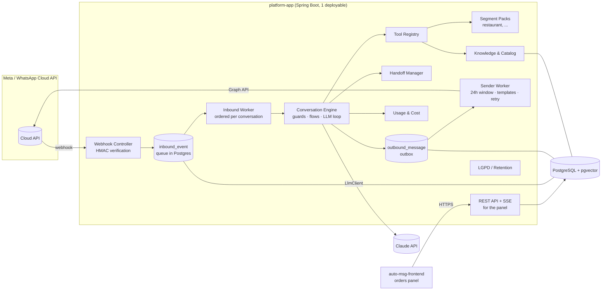

# Architecture — Conversa

> Provisional project name: **auto-msg** (code name: Conversa, package `br.com.conversa`).
> Living document: decisions with trade-offs live in [`docs/adr/`](adr/), business rules in the
> [decision log](decisions.md); this file describes the *how*.

## 1. Overview

Multi-tenant platform that automates WhatsApp customer service (Meta's official Cloud API),
with a hybrid conversation engine (deterministic flows + LLM with tool calling), human handoff
and a knowledge base per business.

Principles:

1. **Generic core, segment as a pack.** No `if (restaurant)` in the core. Everything
   segment-specific lives in a *Segment Pack* (tools, flows, prompts, configuration schema).
   Each business (tenant) picks a pack and customizes it through configuration.
2. **The LLM talks; the code decides.** The LLM understands free text and picks tools. Business
   data (price, opening hours, fee) only comes from tools. Irreversible actions (confirming an
   order) only happen through a deterministic step with a confirmation button.
3. **Fast webhook, asynchronous and idempotent processing.** The webhook only validates, stores
   and answers 200. Everything else runs in workers from queues in PostgreSQL.
4. **Data isolation per tenant from day one** (`tenant_id` + Row-Level Security).
5. **Modular monolith.** One deployable, Maven modules with boundaries checked by ArchUnit.
   Extract services only when there is a measured reason.

## 2. Context and constraints that shape the design

Checked in Meta's documentation on 2026-10-28 (see [ADR-001](adr/ADR-001-whatsapp-integration.md)):

| Fact | Impact on the design |
|---|---|
| Since 2026-01-15 the terms ban **general-purpose AI assistants** on the platform; AI for the business's own customer service is allowed. | The bot is restricted to the business's scope: prompt with a scope guard, polite refusal of off-topic subjects, no "ask me anything". |
| Pricing **per delivered message** (since 2025-07). On **2026-10-01** service messages (free text inside the 24h window) became charged above **1,000/month per number**, and utility templates inside the window are no longer free. | Every bot answer costs money. Consolidate answers into one message, avoid multiple "bubbles", record the `pricing` of status webhooks per tenant. Estimate at 50 orders/day: ~10–15 thousand messages/month → above the free tier. Check the BRL rate card before pricing the product. |
| **Coexistence** (same number in the WhatsApp Business app + Cloud API): echoes of messages sent from the app through the `smb_message_echoes` webhook; fixed throughput of 20 msg/s; requires Embedded Signup and that we are a **Tech Provider/Solution Partner** (or a BSP that supports it). | Handoff uses the restaurant's app (client decision). Echoes pause the bot. Meta onboarding is on the critical path. |
| With coexistence: **no groups**, no new broadcast lists, no catalog/away messages/quick replies in the app; **WhatsApp for Windows is not a supported companion** (messages sent from it produce no echo). | Staff cannot be notified in a group → notification through the panel + individual messages to staff numbers (utility template, paid). The restaurant cannot answer from WhatsApp for Windows (the bot would not see the human). |
| Messages sent from the app **neither open nor extend** the API's 24h window. | The window is computed only from customer messages. |
| Outside the 24h window only **approved templates** can be sent. | Late notifications (e.g. "order is out for delivery") use a utility template if the window closed. |

## 3. Components



### Maven modules

| Module | Responsibility | May depend on |
|---|---|---|
| `platform-core` | Domain kernel: tenant/conversation types, **SPIs** (`SegmentPack`, `Tool`, `LlmClient`, `ChannelGateway`). No Spring Web, no JPA. | JDK |
| `channel-whatsapp` | Cloud API adapter: webhook verification, `X-Hub-Signature-256` signature, payload parsing, sending (text, interactive, template, media), statuses. | `platform-core` |
| `llm-anthropic` | `LlmClient` implementation with the official SDK `com.anthropic:anthropic-java`. | `platform-core` |
| `segment-restaurant` | Restaurant Segment Pack: tools (menu, delivery fee, cart), flows (checkout), prompts, configuration schema. | `platform-core` |
| `platform-app` | Spring Boot: wiring, persistence (JPA + Flyway), queues, workers, panel REST/SSE API, security, observability. | all |

Rule: **segments and adapters never depend on each other** — only on `platform-core`.
`ArchitectureTest` (ArchUnit) breaks the build if this is violated.

## 4. Flow of a message (webhook → answer)

```mermaid
sequenceDiagram
    autonumber
    participant C as Customer (WhatsApp)
    participant M as Meta Cloud API
    participant W as WebhookController
    participant Q as inbound_event (PG)
    participant K as InboundWorker
    participant E as ConversationEngine
    participant L as LlmClient (Claude)
    participant T as Tools (Segment Pack)
    participant O as outbound_message (PG)
    participant S as SenderWorker

    C->>M: "tem pizza de calabresa? quanto custa?"
    M->>W: POST /webhooks/whatsapp (payload + X-Hub-Signature-256)
    W->>W: validate HMAC-SHA256 (app secret) over the raw body
    W->>Q: INSERT ... ON CONFLICT (event_key) DO NOTHING
    W-->>M: 200 OK (< 100 ms)
    K->>Q: SELECT ... FOR UPDATE SKIP LOCKED
    K->>K: resolve tenant by phone_number_id; per-conversation lock (advisory lock)
    K->>E: normalized InboundMessage (tenant, contact, conversation)
    E->>E: guards: LGPD/opt-out · consent · HUMAN state? · opening hours
    alt deterministic flow waiting (e.g. "Confirm order" button)
        E->>E: FlowRuntime advances the state
    else free text
        E->>L: system (pack + tenant) + history + tools
        L-->>E: tool_use search_menu("calabresa")
        E->>T: search_menu (queries the tenant's catalog)
        T-->>E: items + prices
        E->>L: tool_result
        L-->>E: final text
    end
    E->>O: INSERT answer (idempotency key = inbound wamid + seq)
    E->>Q: mark event as PROCESSED (same transaction)
    S->>O: claim pending
    S->>S: 24h window open? otherwise a template is required
    S->>M: POST /{phone_number_id}/messages
    M-->>S: wamid
    M->>W: status webhook (sent/delivered/read + pricing)
    W->>Q: status → updates message + tenant cost
```

Key points:

- **Webhook implemented (M1):** `GET|POST /webhooks/whatsapp`. Each notification is split into
  atomic events keyed `msg:<wamid>`, `status:<wamid>:<status>`, `echo:<wamid>` or
  `<field>:<sha256 of the change>` (other fields). Invalid signature → 401; signed but invalid
  payload → 400; otherwise 200, duplicates included. `tenant_id` stays null until it is
  resolved by `phone_number_id` (M3).
- **Idempotency at 3 levels:** unique `inbound_event.event_key` (message wamid or
  `wamid:status`), unique `outbound_message.idempotency_key`, and business effects (e.g.
  creating an order) with a natural key (`order.confirmation_wamid`).
- **Ordering:** messages of the same conversation are processed serially (advisory lock on
  `(tenant_id, wa_id)`); different conversations in parallel (virtual threads).
- **Debounce:** a customer who sends 3 messages in a row ("oi" / "quero pizza" / "calabresa")
  — the worker waits for ~2 s of silence and processes the batch together, saving LLM calls and
  paid messages.
- **Failures:** retry with exponential backoff; after N attempts the event goes to `FAILED`
  (dead letter) and the conversation is flagged for a human.

## 5. Conversation engine

Details and trade-offs in [ADR-002](adr/ADR-002-conversation-engine.md). Pipeline per turn:

1. **Normalization** — text, button/list reply (`interactive.button_reply.id`), location,
   media, audio (MVP: asks the customer to type; transcription in phase 2).
2. **Deterministic guards** (always before the LLM): LGPD commands ("apagar meus dados"),
   opt-out, privacy notice on first contact, conversation in `HUMAN` (only records), outside
   opening hours (configurable answer).
3. **Flow runtime** — declarative flows (YAML in the pack, overridden per tenant): state
   machines with slots (e.g. checkout: fulfillment type → address → payment → change →
   confirmation). Structured input (button id) moves the flow forward directly, without the
   LLM. Free text inside a flow goes to the LLM with a slot-filling tool.
4. **LLM turn** — prompt = segment pack + tenant configuration (tone, virtual attendant name,
   rules) + conversation state (cart). The LLM may only state facts that came from tools.
   Limit of tool iterations per turn.
5. **Rendering** — code builds interactive messages (buttons/lists) from tool results; the LLM
   writes the text.

Conversation states: `BOT` → `HUMAN` (paused until `paused_until`) → `BOT`; `CLOSED` after
inactivity.

## 6. Human handoff (coexistence)

See [ADR-008](adr/ADR-008-human-handoff.md).

- **Triggers:** the customer asks ("falar com atendente"), the `request_human` tool called by
  the LLM, N misunderstandings in a row, a technical error, or an **echo of a message sent from
  the app** (`smb_message_echoes`) — the human started answering, the bot steps aside.
- **Pause:** `paused_until = now + handoff.pause_minutes` (default 60), renewed on every echo.
- **Back to the bot:** the pause expires, or the "hand back to bot" button in the panel.
- **Staff alert:** a card in the panel + a message to the configured staff numbers.

## 7. Multi-tenant model and segments

See [ADR-003](adr/ADR-003-multi-tenancy.md).

```text
Platform (defaults)
  └── Segment Pack "restaurant" v1   (tools, flows, prompts, config schema, defaults)
        └── Tenant "Restaurante X"   (overrides validated against the pack's schema)
```

- **Segment Pack** = Spring bean implementing `SegmentPack` (SPI in `platform-core`): `id`,
  `version`, `tools()`, resources in `classpath:segments/<id>/` (`flows/*.yaml`,
  `prompts/*.md`, `config-schema.json`, `defaults.yaml`).
- **Tenant** picks `segment_id` + `segment_version` and stores `config` (JSONB) validated by
  the schema: tone of voice, assistant name, enabled tools, rules (minimum order, payment
  methods, neighborhoods and fees), flow texts, staff numbers, retention.
- **Precedence:** platform < pack < tenant.
- **Generic data in the core** (serves many segments): catalog (items, categories, options,
  prices, `attributes jsonb`), opening hours, address/service area, FAQ/policies, contacts.
  **Pack-specific data:** delivery order (restaurant), appointment (clinic/salon, future),
  reservation (future).
- **Isolation:** every business table has `tenant_id` + **RLS** with
  `current_setting('app.tenant_id')`, set by `SET LOCAL` at the start of each transaction. The
  application uses a role without `BYPASSRLS`; migrations run with another role. Queue tables
  (`inbound_event`, `outbound_message`) carry `tenant_id` but have no RLS, because claiming is
  cross-tenant; the worker sets the tenant before touching business data.

## 8. Initial data model


Also planned: `business_hours`, `delivery_zone` (neighborhood → fee), `staff_user`,
`audit_log`, `data_subject_request`. Opening hours and zones may start inside `tenant.config`
and become tables when the panel starts editing them.

## 9. Queue and asynchronous processing

PostgreSQL as a queue (`FOR UPDATE SKIP LOCKED`), no broker in the MVP — see
[ADR-004](adr/ADR-004-async-processing-queue.md). Workers on virtual threads, short polling +
`LISTEN/NOTIFY` for low latency. A `JobQueue` interface allows swapping for RabbitMQ/SQS if
volume justifies it.

## 10. LLM

`LlmClient` (neutral port in `platform-core`) + Anthropic adapter — see
[ADR-005](adr/ADR-005-llm-provider.md). Prompt caching with a stable prefix (tools → pack
system prompt → tenant config) and volatile state at the end. Cost per call stored in
`llm_call` and aggregated per tenant.

## 11. Knowledge base

See [ADR-006](adr/ADR-006-knowledge-base.md). For a restaurant, **structured data through
tools** (menu, prices, fees, opening hours) + **FAQ/policies in the prompt** (small, and they
stay cached). RAG with pgvector only when a tenant's textual knowledge exceeds ~20–30 thousand
tokens. The `vector` extension is already created in the initial migration.

## 12. Panel (MVP)

Decided: an **orders panel** in the MVP (real-time list via SSE, sound alert, status changes
that notify the customer) + **a WhatsApp message to staff**. Human service happens **in the
WhatsApp Business app** (coexistence). A conversations panel and knowledge base editor are left
for phase 2; until then, content is loaded by seed/spreadsheet import.

Technology: the panel is a **separate frontend in its own repository** (`auto-msg-frontend`,
created in M8; stack to be defined, suggestion React + Vite + TypeScript). This repository
(`auto-msg-backend`) exposes a **REST API** (`/api/v1/...`) and an **SSE** stream of order
events, authenticated with the tenant's staff users (HttpOnly cookie session or JWT, to be
decided in M8). The contract is published as OpenAPI. See
[ADR-009](adr/ADR-009-separate-frontend-repository.md).

## 13. LGPD

- **Roles:** restaurant = controller; platform = processor (contract/DPA). Anthropic and Meta
  as sub-processors — international transfer disclosed in the privacy policy.
- **Legal basis:** performance of a contract/preliminary steps (orders) and legitimate interest
  (questions). **Explicit consent only for marketing** (phase 2).
- **Notice on first contact** with a link to the policy; recorded in
  `contact.consent_notice_at`.
- **Minimization:** the LLM gets only what is needed (first name, never the full phone number).
- **Retention configurable per tenant:** messages (default 180 days) → deleted; orders → kept
  for tax purposes, with personal data anonymized after the period.
- **Data subject rights:** the "apagar meus dados" command (and the panel) →
  `data_subject_request` → job that anonymizes the contact, deletes messages and confirms to
  the customer.

## 14. Observability

- Structured JSON logs (`logging.structured.format.console=ecs`) with MDC: `tenant_id`,
  `conversation_id`, `wamid`, `trace_id`.
- Micrometer + OpenTelemetry: one trace per received message, with spans for LLM, tools and
  sending.
- Metrics: webhook latency, queue lag (age of the oldest event), error rate, LLM tokens/cost per
  tenant, WhatsApp messages per pricing category per tenant, handoff rate.
- Actuator: `/actuator/health` (liveness/readiness), `/actuator/prometheus`.

## 15. Deployment

A single VPS with Docker Compose (app + PostgreSQL), TLS through Caddy, daily PostgreSQL backup
to external storage (e.g. S3-compatible). The app image is built by the multi-stage
`Dockerfile`. One process comfortably handles the expected volume (≤ 50 orders/day).
