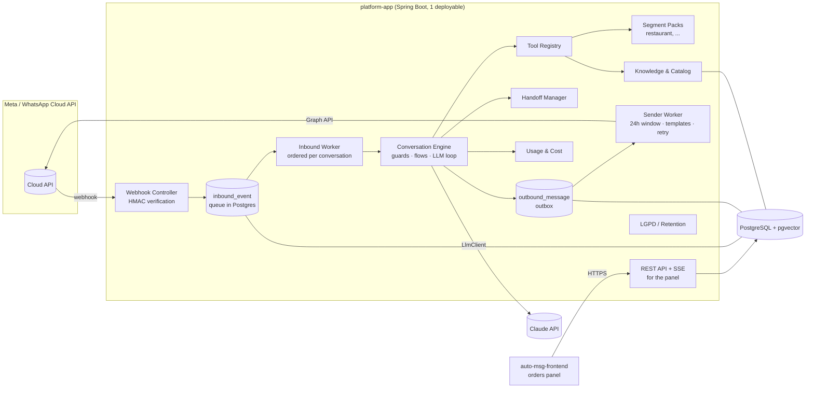
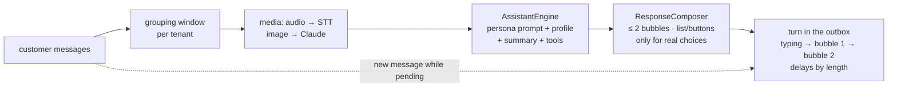
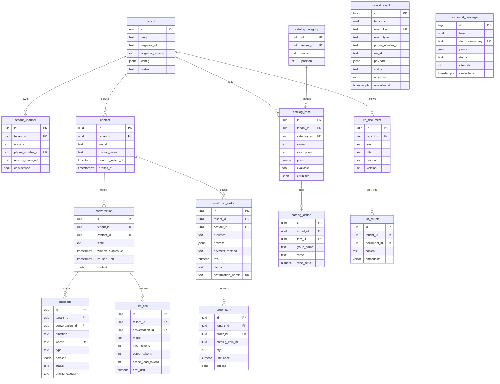

# Architecture — Conversa

> Provisional project name: **auto-msg** (code name: Conversa, package `br.com.conversa`).
> Living document: decisions with trade-offs live in [`docs/adr/`](adr/), business rules in the
> [decision log](decisions.md); this file describes the *how*.

## 1. Overview

Multi-tenant platform that automates WhatsApp customer service (Meta's official Cloud API),
with a hybrid conversation engine (deterministic flows + LLM with tool calling), human handoff
and a knowledge base per business.

Principles:

1. **Generic core, segment as a pack.** No `if (restaurant)` in the core. Everything
   segment-specific lives in a *Segment Pack* (tools, flows, prompts, configuration schema).
   Each business (tenant) picks a pack and customizes it through configuration.
2. **The LLM talks; the code decides.** The LLM understands free text and picks tools. Business
   data (price, opening hours, fee) only comes from tools. Irreversible actions (confirming an
   order) only happen through a deterministic step with a confirmation button.
3. **Fast webhook, asynchronous and idempotent processing.** The webhook only validates, stores
   and answers 200. Everything else runs in workers from queues in PostgreSQL.
4. **Data isolation per tenant from day one** (`tenant_id` + Row-Level Security).
5. **Modular monolith.** One deployable, Maven modules with boundaries checked by ArchUnit.
   Extract services only when there is a measured reason.
6. **Feels like the business's own staff** (D-012, ADR-011). Persona per business, natural short
   messages at a human pace, free conversation, memory of the customer; never claiming to be
   human, never inventing a fact.

## 2. Context and constraints that shape the design

Checked in Meta's documentation on 2026-10-28 (see [ADR-001](adr/ADR-001-whatsapp-integration.md)):

| Fact | Impact on the design |
|---|---|
| Since 2026-01-15 the terms ban **general-purpose AI assistants** on the platform; AI for the business's own customer service is allowed. | The bot is restricted to the business's scope: prompt with a scope guard, polite refusal of off-topic subjects, no "ask me anything". |
| Pricing **per delivered message** (since 2025-07). On **2026-10-01** service messages (free text inside the 24h window) became charged above **1,000/month per number**, and utility templates inside the window are no longer free. | Every bot answer costs money. Consolidate answers into one message, avoid multiple "bubbles", record the `pricing` of status webhooks per tenant. Estimate at 50 orders/day: ~10–15 thousand messages/month → above the free tier. Check the BRL rate card before pricing the product. |
| **Coexistence** (same number in the WhatsApp Business app + Cloud API): echoes of messages sent from the app through the `smb_message_echoes` webhook; fixed throughput of 20 msg/s; requires Embedded Signup and that we are a **Tech Provider/Solution Partner** (or a BSP that supports it). | Handoff uses the restaurant's app (client decision). Echoes pause the bot. Meta onboarding is on the critical path. |
| With coexistence: **no groups**, no new broadcast lists, no catalog/away messages/quick replies in the app; **WhatsApp for Windows is not a supported companion** (messages sent from it produce no echo). | Staff cannot be notified in a group → notification through the panel + individual messages to staff numbers (utility template, paid). The restaurant cannot answer from WhatsApp for Windows (the bot would not see the human). |
| Messages sent from the app **neither open nor extend** the API's 24h window. | The window is computed only from customer messages. |
| Outside the 24h window only **approved templates** can be sent. | Late notifications (e.g. "order is out for delivery") use a utility template if the window closed. |

## 3. Components



### Maven modules

| Module | Responsibility | May depend on |
|---|---|---|
| `platform-core` | Domain kernel: tenant/conversation types, **SPIs** (`SegmentPack`, `Tool`, `LlmClient`, `ChannelGateway`). No Spring Web, no JPA. | JDK |
| `channel-whatsapp` | Cloud API adapter: webhook verification, `X-Hub-Signature-256` signature, payload parsing, sending (text, interactive, template, media), statuses. | `platform-core` |
| `llm-anthropic` | `LlmClient` implementation with the official SDK `com.anthropic:anthropic-java`. | `platform-core` |
| `segment-restaurant` | Restaurant Segment Pack: tools (menu, delivery fee, cart), flows (checkout), prompts, configuration schema. | `platform-core` |
| `platform-app` | Spring Boot: wiring, persistence (JPA + Flyway), queues, workers, panel REST/SSE API, security, observability. | all |

Rule: **segments and adapters never depend on each other** — only on `platform-core`.
`ArchitectureTest` (ArchUnit) breaks the build if this is violated.

## 4. Flow of a message (webhook → answer)

```mermaid
sequenceDiagram
    autonumber
    participant C as Customer (WhatsApp)
    participant M as Meta Cloud API
    participant W as WebhookController
    participant Q as inbound_event (PG)
    participant K as InboundWorker
    participant E as ConversationEngine
    participant L as LlmClient (Claude)
    participant T as Tools (Segment Pack)
    participant O as outbound_message (PG)
    participant S as SenderWorker

    C->>M: "tem pizza de calabresa? quanto custa?"
    M->>W: POST /webhooks/whatsapp (payload + X-Hub-Signature-256)
    W->>W: validate HMAC-SHA256 (app secret) over the raw body
    W->>Q: INSERT ... ON CONFLICT (event_key) DO NOTHING
    W-->>M: 200 OK (< 100 ms)
    K->>Q: SELECT ... FOR UPDATE SKIP LOCKED
    K->>K: resolve tenant by phone_number_id; per-conversation lock (advisory lock)
    K->>E: normalized InboundMessage (tenant, contact, conversation)
    E->>E: guards: LGPD/opt-out · consent · HUMAN state? · opening hours
    alt deterministic flow waiting (e.g. "Confirm order" button)
        E->>E: FlowRuntime advances the state
    else free text
        E->>L: system (pack + tenant) + history + tools
        L-->>E: tool_use search_menu("calabresa")
        E->>T: search_menu (queries the tenant's catalog)
        T-->>E: items + prices
        E->>L: tool_result
        L-->>E: final text
    end
    E->>O: INSERT answer (idempotency key = inbound wamid + seq)
    E->>Q: mark event as PROCESSED (same transaction)
    S->>O: claim pending
    S->>S: 24h window open? otherwise a template is required
    S->>M: POST /{phone_number_id}/messages
    M-->>S: wamid
    M->>W: status webhook (sent/delivered/read + pricing)
    W->>Q: status → updates message + tenant cost
```

Key points:

- **Webhook implemented (M1):** `GET|POST /webhooks/whatsapp`. Each notification is split into
  atomic events keyed `msg:<wamid>`, `status:<wamid>:<status>`, `echo:<wamid>` or
  `<field>:<sha256 of the change>` (other fields). Invalid signature → 401; signed but invalid
  payload → 400; otherwise 200, duplicates included. `tenant_id` is resolved from the
  `phone_number_id` when the event is stored (null for numbers no tenant registered; their
  messages are not answered).
- **Workers implemented (M2):**
  - `InboundWorker` handles one `inbound_event` per transaction (`FOR UPDATE SKIP LOCKED`) in
    arrival order. Statuses update `outbound_message` (`delivery_status` only moves forward,
    plus `pricing_category`/`billable`). Customer messages go to their conversation (M5, see
    section 5). Echoes and other fields
    are only stored until M6. A failure rolls back and is retried with backoff; after
    `max-attempts` the event is `FAILED`.
  - `SenderWorker` claims due `outbound_message` rows with a lease (`PROCESSING` +
    `available_at = now() + lease`), so no connection is held during the HTTP call and a crashed
    sender's rows are claimed again (at-least-once delivery). Free text outside the 24h window
    is failed with `WINDOW_CLOSED` without calling Meta; templates and read receipts always go.
    Retryable errors (HTTP 429/5xx, network, Meta rate-limit codes) back off exponentially with
    jitter; others fail at once.
  - The 24h window is the customer's latest message `timestamp` in `inbound_event` until the
    `conversation` table (with `window_expires_at`) arrives with the conversation engine.
  - Sending goes through the `ChannelGateway` port (`platform-core`), implemented by
    `WhatsAppCloudApiGateway`, with the token of the sending number (see section 7).
  - A single worker of each kind runs (scheduled polling); advisory locks and `LISTEN/NOTIFY`
    come with parallel workers.
- **Idempotency at 3 levels:** unique `inbound_event.event_key` (message wamid or
  `wamid:status`), unique `outbound_message.idempotency_key`, and business effects (e.g.
  creating an order) with a natural key (`order.confirmation_wamid`).
- **Ordering:** messages of the same conversation are processed serially (advisory lock on
  `(tenant_id, wa_id)`); different conversations in parallel (virtual threads).
- **Debounce:** a customer who sends 3 messages in a row ("oi" / "quero pizza" / "calabresa")
  — the worker waits for ~2 s of silence and processes the batch together, saving LLM calls and
  paid messages.
- **Failures:** retry with exponential backoff; after N attempts the event goes to `FAILED`
  (dead letter) and the conversation is flagged for a human.

## 5. Conversation engine

Details and trade-offs in [ADR-002](adr/ADR-002-conversation-engine.md). Pipeline per turn:

1. **Normalization** — text, button/list reply (`interactive.button_reply.id`), location,
   media, audio (MVP: asks the customer to type; transcription in phase 2).
2. **Deterministic guards** (always before the LLM): LGPD commands ("apagar meus dados"),
   opt-out, privacy notice on first contact, conversation in `HUMAN` (only records), outside
   opening hours (configurable answer).
3. **Flow runtime** — declarative flows (YAML in the pack, overridden per tenant): state
   machines with slots (e.g. checkout: fulfillment type → address → payment → change →
   confirmation). Structured input (button id) moves the flow forward directly, without the
   LLM. Free text inside a flow goes to the LLM with a slot-filling tool.
4. **LLM turn** — prompt = segment pack + tenant configuration (tone, virtual attendant name,
   rules) + conversation state (cart). The LLM may only state facts that came from tools.
   Limit of tool iterations per turn.
5. **Rendering** — code builds interactive messages (buttons/lists) from tool results; the LLM
   writes the text.

Conversation states: `BOT` → `HUMAN` (paused until `paused_until`) → `BOT`; `CLOSED` after
inactivity.

**Implemented (M5):** steps 1 and 4; guards and flows arrive with M6, M7 and M9.

- `InboundEventProcessor` stores each customer message once in `message` (by wamid), creating
  `contact` and `conversation`; media become markers (`[áudio]`, `[imagem] <caption>`). When the
  assistant is on and an LLM is configured, it sets `conversation.reply_due_at = now + debounce`
  (2 s), so a burst of messages gets one answer.
- `ReplyWorker` claims due conversations with a lease (owner role, like the queues), and
  `AssistantEngine` builds the answer outside any transaction: system prompt from the pack
  (`prompts/system.md`, filled from the tenant configuration), the pack's tools, and the latest 30
  messages as plain-text turns, with the current time as a block of the last customer turn. The
  tool loop validates every tool input against its schema (networknt) before running it, allows 4
  rounds, and replays each model turn unchanged. Refusals get a polite refusal text; failures,
  empty answers or too many rounds get a fallback text; temporary LLM failures are retried 3 times
  (5 s apart) first. The answer, its read receipt and the text are stored and enqueued in one
  tenant transaction, keyed by the last customer wamid (`reply:<conversation>:<wamid>`), so a
  retry never sends twice; a customer message that arrives meanwhile reschedules the answer.
- `AnthropicLlmClient` (SDK `anthropic-java`): cache breakpoint on the system prompt plus
  automatic caching of the history, `output_config.effort` (default `low`, per tenant
  `llm.effort`), model per tenant (`llm.model`), no sampling parameters, server-side refusal
  fallback (`fallbacks: "default"`, beta) where the model supports it.
- Every model call writes `llm_call` (tokens, cache reads/writes, cost in USD from the price table
  `conversa.llm.prices`, the model that actually answered).
- Eval: `AssistantEval` runs `eval/restaurant-questions.json` (56 synthetic questions) against the
  real API and a synthetic restaurant, graded by required tools, expected phrases and "no invented
  prices", and writes `target/eval-report.md`. It never runs in the build; running it costs money.

### 5.1 Humanized service (ADR-011, planned: roadmap track H)



- **Persona and prompt (implemented, H2).** `persona` in the tenant configuration renders into a versioned prompt
  template (`prompt_template`: segment default, optional tenant override, draft/published).
  Configuration has draft and published versions (`tenant_config_version`); the simulator runs the
  draft.
  `PersonaPrompt` renders `{{persona}}` and `{{config.path}}` placeholders; `PromptTemplates`
  seeds the pack's `prompts/system.md` as a new published segment default whenever it changes;
  `TenantService.saveDraft` / `publishDraft` keep `tenant.config` as the published version.
  `PersonaTexts` holds the per-tone fixed texts and replaces any answer that claims to be human.
- **Composition (implemented, H3).** The engine's answer goes through `ResponseComposer`, which splits it into at most
  `humanization.maxBubbles` (≤ 2, D-014) and turns a small set of options into an interactive list
  or buttons. Fixed texts (refusal, failure, handoff, confirmation) are deterministic, per tone.
- **Pace (implemented, H3).** A *turn* is a typing indicator (`status: read` + `typing_indicator`) followed by bubbles
  scheduled in the outbox with `available_at` = previous + delay(length), within the tenant's
  minimum and maximum; the indicator is refreshed before each bubble. No thread sleeps.
  `TurnSender` enqueues the turn (`turn_id`, `turn_seq`, `available_at` from `HumanPace`); the
  assistant marks splits with `---` and offers choices with the `offer_options` control tool
  (buttons up to 3, a list up to 10). Settings: `humanization` in the tenant configuration.
- **Grouping and interruptions (implemented, H4).** The silence window is per tenant (default 4 s). A customer message
  that arrives while a turn still has pending bubbles cancels them (`turn_id`), and the answer is
  rebuilt with the new message.
  `TurnCancellation` marks the pending rows `CANCELLED` and keeps in the history only the messages
  already sent (or removes the stored answer); `conversa.assistant.debounce`, when set, overrides
  the tenant window (tests).
- **Memory (implemented, H5).** Cart slots stay in the pack's conversation state; `conversation_summary` keeps a
  rolling summary of long conversations (`ConversationSummarizer`, a cheap model every 10 uncovered
  older messages); `CustomerMemory` reads the WhatsApp first name, latest 3 orders and last delivery
  address from the contact and its orders (no separate profile table), and both go to the model in the
  turn context; this replaces the planned `customer_profile`, which would have kept the preferred name, last
  address/neighborhood and latest orders, under retention and erasure.
- **Media.** Images are sent to Claude; audio is transcribed through the `SpeechToText` port
  (`stt-openai`, ADR-012) and stored as text. Failures ask the customer to write or hand over.
- **Confirmation by text** (D-016): right after the latest summary, a fixed rule recognizes clear
  confirmations ("pode mandar", "confirmo") as the tap; the LLM never confirms.

## 6. Human handoff (coexistence)

See [ADR-008](adr/ADR-008-human-handoff.md).

- **Triggers:** the customer asks ("falar com atendente"), the `request_human` tool called by
  the LLM, N misunderstandings in a row, a technical error, or an **echo of a message sent from
  the app** (`smb_message_echoes`) — the human started answering, the bot steps aside.
- **Pause:** `paused_until = now + handoff.pause_minutes` (default 60, renewed on every echo; from
  track H: until staff hand back, with 4 h without a staff reply as safety net, D-015).
- **Back to the bot:** the pause expires, or the "hand back to bot" button in the panel.
- **Staff alert:** a card in the panel + a message to the configured staff numbers.

**Implemented (M6):**

- Echoes (`smb_message_echoes`) are stored as `message` rows by `STAFF` and pause the bot
  (`state = HUMAN`, `handoff_reason = STAFF_REPLY`, pending answer cancelled); every new echo
  renews `paused_until`. No alert: staff are already in the conversation.
- `ReplyWorker` checks, in order: a plain request for a person in the customer's last message
  (`HandoffService.asksForPerson`, no model call); the assistant's control tool `request_human`
  (added by the engine to every pack, with a reason); a second consecutive fallback answer
  (`conversation.failure_streak`, threshold `conversa.handoff.failure-threshold`). Each of these
  sends the customer a fixed notice, alerts every `staffNumbers` entry with the template
  `conversa.handoff.staff-alert-template` (two body parameters: customer name with the last 4
  digits of the number, and the reason) and pauses the bot.
- While `HUMAN`, customer messages are only stored. The first customer message after
  `paused_until` hands the conversation back to the bot (no sweep job needed: the bot only acts on
  customer messages); staff messages appear in its history marked as the team's.
- An answer is delivered only if the bot is still in charge and no newer customer message arrived
  while it was built (the next answer covers it). History is ordered by arrival, since Meta's
  timestamps have one-second resolution.
- Complaints and questions about existing orders go to staff with `request_human`; orders are
  taken by the assistant (M7, below).

**Orders (M7, D-004..D-007):**

- The restaurant pack's draft tools (`add_to_cart`, `update_cart`, `view_cart`,
  `set_fulfillment`, `set_payment`) keep the cart in the pack's conversation state
  (`ConversationState` → `conversation.context`). The cart stores choices only (codes,
  quantities, option names, address, payment); every view prices it again from the catalog and the
  delivery zones (`CartPricing`) and lists what is still `missing` (items, delivery or pickup,
  address and served neighborhood, minimum order for delivery, payment, cash change).
- `start_checkout` refuses an incomplete cart (the LLM asks for what is missing) and, while hours
  are registered, a closed restaurant. A complete cart ends the turn with a `CheckoutRequest`: an
  `OrderDraft` priced by code and its pt-BR summary. `ReplyWorker` stores it as a pending
  `checkout` (earlier pending ones are superseded) and sends the summary with the reply buttons
  `Confirmar pedido` (`confirm:<checkout>`) and `Alterar` (`edit:<checkout>`); a summary over the
  1,024-character button limit goes as text first.
- Only a tap on `confirm:` creates an order, deterministically and without the LLM
  (`OrderService.confirm`): the pending checkout becomes `customer_order` + `order_item` exactly
  as summarized, with a per-tenant number (`order_sequence`) and the tap's wamid as
  `confirmation_wamid` (unique). A second tap answers that it is already confirmed; a tap on a
  summary superseded by any later cart change (`ConversationState.write` supersedes pending
  checkouts) answers that it is outdated. The customer gets a confirmation and the staff numbers
  the `conversa.orders.staff-alert-template` alert; the cart is cleared.
- Typed confirmations ("confirmo") are never orders: the prompt asks the customer to tap.

## 7. Multi-tenant model and segments

See [ADR-003](adr/ADR-003-multi-tenancy.md).

```text
Platform (defaults)
  └── Segment Pack "restaurant" v1   (tools, flows, prompts, config schema, defaults)
        └── Tenant "Restaurante X"   (overrides validated against the pack's schema)
```

- **Segment Pack** = Spring bean implementing `SegmentPack` (SPI in `platform-core`): `id`,
  `version`, `tools()`, resources in `classpath:segments/<id>/` (`flows/*.yaml`,
  `prompts/*.md`, `config-schema.json`, `defaults.yaml`).
- **Tenant** picks `segment_id` + `segment_version` and stores `config` (JSONB) validated by
  the schema: tone of voice, assistant name, enabled tools, rules (minimum order, payment
  methods, neighborhoods and fees), flow texts, staff numbers, retention.
- **Precedence:** platform < pack < tenant.
- **Generic data in the core** (serves many segments): catalog (items, categories, options,
  prices, `attributes jsonb`), opening hours, address/service area, FAQ/policies, contacts.
  **Pack-specific data:** delivery order (restaurant), appointment (clinic/salon, future),
  reservation (future).
- **Isolation:** every business table has `tenant_id` + **RLS** with
  `current_setting('app.tenant_id')`. Business work runs through `TenantTransactions`, which sets
  `app.tenant_id` for the transaction and switches to the `conversa_app` role
  (`SET LOCAL ROLE`), which does not bypass RLS; see [ADR-010](adr/ADR-010-rls-enforcement.md).
  An unset tenant matches no row. Queue tables (`inbound_event`, `outbound_message`) carry
  `tenant_id` but have no RLS, because claiming is cross-tenant; workers bind the tenant before
  touching business data.
- **Implemented (M3):** `tenant` and `tenant_channel` under RLS; the edge resolves the tenant of a
  `phone_number_id` with the `SECURITY DEFINER` functions `channel_tenant_id` and
  `channel_access_token_ref`. `SegmentPackRegistry` holds the deployed packs (one version each);
  `TenantConfigResolver` merges the pack's `defaults.json` with the tenant's own settings and
  validates the result against `config-schema.json` (JSON Schema 2020-12). Tenants store only
  their own settings. Until onboarding from the panel, `TenantBootstrap` seeds one tenant and its
  number at startup from `conversa.bootstrap.*` (the pilot restaurant; the test number in
  development).
- **Implemented (M4):** generic business data in the core: `catalog_category`, `catalog_item`
  (unique business `code`), `catalog_option`, `business_hours` (ISO day, periods past midnight)
  and `delivery_zone`, all under RLS, plus `tenant.timezone`. The `BusinessDirectory` port
  (`platform-core`, implemented by `JdbcBusinessDirectory`) reads them inside the tenant context;
  `TenantSettings` exposes the effective configuration. `BusinessDataImporter` loads them from CSV
  ([`IMPORT.md`](IMPORT.md)), all-or-nothing per file, from `conversa.bootstrap.data-dir` at
  startup. The restaurant pack's read tools are `search_menu`, `get_business_hours`,
  `get_delivery_fee` and `get_business_info`; they return JSON with amounts both as numbers and
  formatted in pt-BR, and say explicitly when data is not registered (`menuRegistered`,
  `hoursRegistered`, `zonesRegistered` = false) so the LLM never fills the gap. Matching ignores
  case, accents and plurals (`SearchText`, `CatalogSearch`).
- **Access tokens:** `tenant_channel.access_token_ref` names a property or environment variable
  holding that number's Cloud API token; the database never holds tokens. Numbers without one use
  the platform token (`WHATSAPP_ACCESS_TOKEN`).

## 8. Initial data model



Also in M4: `business_hours` and `delivery_zone` (neighborhood → fee). Planned: `staff_user`,
`audit_log`, `data_subject_request`.

## 9. Queue and asynchronous processing

PostgreSQL as a queue (`FOR UPDATE SKIP LOCKED`), no broker in the MVP — see
[ADR-004](adr/ADR-004-async-processing-queue.md). Workers on virtual threads, short polling +
`LISTEN/NOTIFY` for low latency. A `JobQueue` interface allows swapping for RabbitMQ/SQS if
volume justifies it.

## 10. LLM

`LlmClient` (neutral port in `platform-core`) + Anthropic adapter — see
[ADR-005](adr/ADR-005-llm-provider.md). Prompt caching with a stable prefix (tools → pack
system prompt → tenant config) and volatile state at the end. Cost per call stored in
`llm_call` and aggregated per tenant.

## 11. Knowledge base

See [ADR-006](adr/ADR-006-knowledge-base.md). For a restaurant, **structured data through
tools** (menu, prices, fees, opening hours) + **FAQ/policies in the prompt** (small, and they
stay cached). RAG with pgvector only when a tenant's textual knowledge exceeds ~20–30 thousand
tokens. The `vector` extension is already created in the initial migration.

## 12. Panel (MVP)

**Scope extended by D-013 (track H):** besides orders, the panel edits the persona and the human-pace
settings (draft → publish, admin role), runs a WhatsApp-like simulator of the draft, and shows
conversations with bot, staff and customer messages and the order in progress, where staff take
over and hand back.

Decided: an **orders panel** in the MVP (real-time list via SSE, sound alert, status changes
that notify the customer) + **a WhatsApp message to staff**. Human service happens **in the
WhatsApp Business app** (coexistence). A conversations panel and knowledge base editor are left
for phase 2; until then, content is loaded by seed/spreadsheet import.

Technology (D-010): the panel is a **separate public repository** (`auto-msg-frontend`) built
with React + Vite + TypeScript, served as static files from the same origin as the API (Caddy in
production, the Vite proxy in development). This repository exposes a **REST API**
(`/api/v1/...`) and an **SSE** stream; the contract is [`docs/api/openapi.yaml`](api/openapi.yaml).
See [ADR-009](adr/ADR-009-separate-frontend-repository.md).

**Implemented (M8, backend):**

- **Staff sign-in:** `staff_user` (bcrypt hashes, e-mail unique across tenants, V9), looked up by
  the `SECURITY DEFINER` function `staff_login` before the tenant is known. Spring Security with a
  server session in the HttpOnly cookie `CONVERSA_SESSION` (12 h, `SameSite=Lax`, `Secure` behind
  HTTPS) and CSRF tokens for single-page apps (`XSRF-TOKEN` cookie → `X-XSRF-TOKEN` header). The
  webhook and health check stay public; everything else under `/api` needs a staff session, and
  every query runs in that staff member's tenant. The pilot's user comes from `BOOTSTRAP_STAFF_*`.
- **Orders board:** `OrderBoard` lists open orders (or the last 24 h) with items and the customer's
  WhatsApp name and number, and moves them through RECEIVED → PREPARING → OUT_FOR_DELIVERY /
  READY_FOR_PICKUP → COMPLETED (or CANCELLED). Each move notifies the customer (D-011): text inside
  the 24h window, otherwise the status template (`ORDERS_TEMPLATE_*`), or nothing if none.
- **Live events:** `PanelEventStream` keeps the SSE connections per tenant in this process and
  sends `order.created`, `order.updated`, `conversation.handoff` and `conversation.resumed` after the
  transaction commits, with a heartbeat every 25 s. The panel refetches what an event names.
- **Handoffs:** the panel lists conversations staff are handling and hands them back to the bot.

## 13. LGPD

- **Roles:** restaurant = controller; platform = processor (contract/DPA). Anthropic and Meta
  as sub-processors — international transfer disclosed in the privacy policy.
- **Legal basis:** performance of a contract/preliminary steps (orders) and legitimate interest
  (questions). **Explicit consent only for marketing** (phase 2).
- **Notice on first contact** with a link to the policy; recorded in
  `contact.consent_notice_at`.
- **Minimization:** the LLM gets only what is needed (first name, never the full phone number).
- **Retention configurable per tenant:** messages (default 180 days) → deleted; orders → kept
  for tax purposes, with personal data anonymized after the period.
- **Data subject rights:** the "apagar meus dados" command (and the panel) →
  `data_subject_request` → job that anonymizes the contact, deletes messages and confirms to
  the customer.

**Implemented (M9):**

- **Notice:** the first bot answer to each customer (or the handoff notice) starts with the
  privacy notice, with the tenant's `privacy.policyUrl` when set, in the same paid message
  (`PrivacyService.withNotice`, `contact.consent_notice_at`).
- **Erasure:** a plain request ("apagar meus dados", "excluir meus dados"...) gets a confirmation
  with buttons; "Sim, apagar" deletes the conversation's messages, clears its state and checkouts,
  removes address, change and notes from the customer's orders (kept for tax purposes) and
  anonymizes the contact (`wa_id = erased:<id>`, no name), then confirms. The customer's queue
  rows (`inbound_event`, `outbound_message`) are anonymized in a second phase, once the
  confirmation left the outbox, because the 24h window check reads them (`purgeQueues`, every
  minute). A new message from the same number starts a new contact.
- **Retention:** `RetentionJob`, daily at 03:30 (São Paulo): after `retention.messageDays`
  (default 180) messages and queue rows are deleted, old orders lose address, change and notes,
  old checkouts lose their drafts, and contacts with nothing recent are anonymized; events of
  unregistered numbers go after 30 days. `llm_call` has no personal data and is kept.

## 14. Observability

- Structured JSON logs (`logging.structured.format.console=ecs`) with MDC: `tenant_id`,
  `conversation_id`, `wamid`, `trace_id`.
- Micrometer + OpenTelemetry: one trace per received message, with spans for LLM, tools and
  sending.
- Metrics: webhook latency, queue lag (age of the oldest event), error rate, LLM tokens/cost per
  tenant, WhatsApp messages per pricing category per tenant, handoff rate.
- Actuator: `/actuator/health` (liveness/readiness), `/actuator/prometheus`.
- **Implemented (M9):** `OperationsMetrics` exports, per tenant slug, `conversa_llm_cost_usd`,
  `conversa_llm_tokens` (by type), `conversa_whatsapp_billable_messages` (delivered and billable,
  by pricing category), `conversa_handoffs` (by reason), `conversa_orders` and
  `conversa_orders_value_brl`, plus the gauges `conversa_queue_inbound_lag_seconds`,
  `conversa_queue_outbound_pending` and `conversa_conversations_human`. Prometheus and the Grafana
  dashboard "Conversa — operação" are provisioned from `deploy/` (profile `ops`).

## 15. Deployment

A single VPS with Docker Compose (app + PostgreSQL), TLS through Caddy, daily PostgreSQL backup
to external storage (e.g. S3-compatible). The app image is built by the multi-stage
`Dockerfile`. One process comfortably handles the expected volume (≤ 50 orders/day).

**Implemented (M9):** [`deploy/docker-compose.prod.yml`](../deploy/docker-compose.prod.yml) and
[`DEPLOY.md`](DEPLOY.md): Caddy built from the panel repository (TLS, panel, proxy of `/api`,
`/webhooks` and the health check), the app, PostgreSQL, a daily `pg_dump` checked with
`pg_restore --list` and kept 14 days (`deploy/backup/`), an optional rclone copy off the server,
and optional Prometheus + Grafana. `BackupRestoreIT` restores a backup into a new database with the
same scripts.
